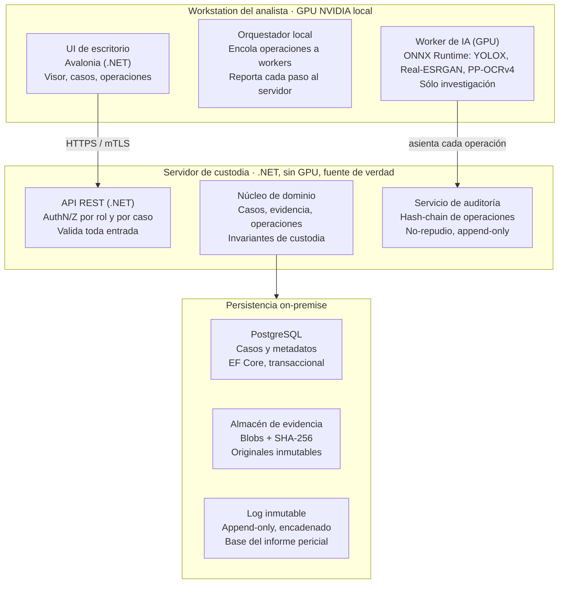

# Sistema Forense de Imagen — Arquitectura y Roadmap

> Versión original: 21 de octubre de 2026 · Yago Gomez. Este archivo es la fuente versionada; los cambios de diseño se hacen acá, por PR.

Sistema open-source, on-premise y multi-analista para análisis forense de video/imagen, que reemplaza progresivamente a Amped FIVE en mejora de imagen, gestión de evidencia con cadena de custodia y analítica automática. Arquitectura híbrida: cliente de escritorio que usa la GPU NVIDIA local para el cómputo pesado, y un servidor central liviano que es la única fuente de verdad de la evidencia y la cadena de custodia.

## Decisión y resumen ejecutivo

**La cadena de custodia es la arquitectura, no un módulo.** En análisis forense el activo crítico no son los filtros — OpenCV y los modelos open-source igualan o superan a los de Amped FIVE — sino el registro inmutable y reproducible de qué se le hizo a cada imagen, con qué parámetros, por quién y cuándo. Todo el sistema se diseña alrededor de ese núcleo; los filtros y la IA son plugins.

**Arquitectura elegida: híbrida (cliente de escritorio con GPU + servidor de custodia liviano).** El cómputo pesado corre en la workstation del analista, aprovechando su GPU NVIDIA sin costo de infraestructura. El servidor central no procesa imágenes: sólo custodia, versiona y audita. Cada operación que ejecuta el cliente se asienta en el servidor de forma inmutable (hash original, operación, parámetros, hash resultante, analista, timestamp). Así se obtienen las dos propiedades que estaban en tensión: máximo rédito de la GPU local y una cadena de custodia centralizada, única y defendible pericialmente.

**Por qué .NET en el núcleo y Python en los workers.** La lógica forense (casos, evidencia, invariantes de custodia, auditoría) vive en .NET: tipado fuerte, EF Core para una persistencia auditable, y un dominio desacoplado de cualquier librería de imagen. El procesamiento (OpenCV, PyTorch, super-resolución) vive en workers Python, que es donde ese ecosistema es nativo. El núcleo nunca depende del motor de turno; hoy es OpenCV, mañana un modelo propio, y la custodia no se entera.

**Por qué monolito modular y no microservicios.** Para un servidor interno con pocos analistas, los microservicios distribuirían la cadena de custodia — transacciones y auditoría repartidas — que es justo lo que no conviene fragmentar. Se arranca como monolito modular con bounded contexts bien separados; si un worker de IA necesitara escalar, se extrae después. No al revés.

> **Nota legal y pericial:** este sistema reemplaza a Amped FIVE construyendo capacidades equivalentes con herramientas open-source y código propio. No depende de ingeniería inversa de Amped ni de ningún binario propietario — esa dependencia sería deuda técnica insostenible y, sobre todo, un vector de impugnación de la prueba en sede judicial.

## Alcance y requisitos

El sistema cubre tres frentes, en orden de prioridad de construcción: la gestión de evidencia con cadena de custodia primero (es el cimiento), luego la mejora de imagen, y por último la analítica automática.

**Requisitos funcionales (RF):**

1. Ingesta de evidencia con cálculo de hash (SHA-256) en el momento de entrada y verificación de integridad en cada lectura.
2. Registro inmutable de cada operación forense: entrada, operación, parámetros, salida, analista y timestamp, encadenados (hash-chain).
3. Gestión de casos: agrupación de evidencias, estados, asignación de analistas, control de acceso por caso.
4. Mejora de imagen: deblur, denoise, super-resolución, corrección de perspectiva y geométrica, estabilización de video.
5. Analítica: detección de objetos/personas/patentes, OCR, tracking, comparación — siempre como operaciones registradas, no como cajas negras.
6. Reproducibilidad: desde el log, regenerar la salida a partir del original aplicando las mismas operaciones y parámetros.
7. Informe pericial: exportar el historial completo de un caso con operaciones, parámetros, hashes y resultados.

**Requisitos no funcionales (RNF):**

1. Integridad y no-repudio: ninguna operación puede alterar el log sin dejar rastro detectable.
2. On-premise, red interna aislada; sin dependencia de internet para operar.
3. Multi-analista concurrente sobre el mismo repositorio de casos, con autorización por rol y por caso.
4. Trazabilidad auditable por un tercero (perito de contraparte, juez) sin acceso al código.
5. Determinismo donde sea posible: misma entrada y parámetros producen la misma salida, o se documenta explícitamente cuando un modelo no es determinista.

**Fuera de alcance (por ahora):** analítica en tiempo real sobre streams en vivo, despliegue en cloud pública, y cualquier integración con Amped FIVE u otro software propietario. Se documentan aquí para fijar los límites, no porque se descarten para siempre.

> **Decisión abierta:** el modelo de determinismo de los modelos de deep learning (misma GPU, misma versión de driver, seeds fijos) necesita una prueba de concepto temprana — es un requisito pericial sensible y conviene validarlo antes de comprometerse.

## Arquitectura general

El cómputo corre en el cliente y la custodia vive en el servidor. La workstation usa su GPU para procesar, pero cada paso que ejecuta queda asentado en el servidor de custodia, que no tiene GPU porque no procesa imágenes: sólo guarda, versiona y audita. La persistencia separa tres cosas que no deben mezclarse — metadatos de casos, los blobs de evidencia, y el log inmutable de operaciones.

El flujo típico: el analista abre una evidencia (el cliente verifica su hash contra el servidor), aplica una operación (un worker Python la ejecuta en la GPU), y el orquestador reporta al servidor qué se hizo, con qué parámetros y el hash del resultado. El servidor encadena ese registro al log. La imagen procesada puede guardarse donde convenga, pero el acta de lo que se hizo es única, central e inmutable.

## Modelo de dominio forense

El dominio tiene cuatro agregados y un puñado de invariantes que no se negocian. Esta es la parte que justifica DDD: estas reglas son el valor pericial del sistema y deben vivir aisladas de cualquier librería.

**Agregados (raíces de consistencia):**

| Agregado | Qué protege | Invariante principal |
|---|---|---|
| `Caso` | Expediente: evidencias, analistas asignados, estado | Una evidencia pertenece a un y sólo un caso; el acceso se autoriza a nivel de caso |
| `Evidencia` | El original y sus derivados | El hash del original nunca cambia; los derivados siempre referencian su padre |
| `OperacionForense` | Un paso de procesamiento aplicado | Es inmutable una vez registrada; guarda tipo, parámetros, hash de entrada y de salida |
| `RegistroDeCustodia` | La cadena encadenada de operaciones | Append-only; cada registro incluye el hash del anterior (hash-chain) |

**Invariantes de la cadena de custodia (reglas de negocio duras):**

1. Toda evidencia que entra se hashea (SHA-256) antes de cualquier otra cosa. Sin hash, no hay ingesta.
2. Ninguna operación modifica el original: siempre produce un derivado nuevo, con su propio hash.
3. Cada `OperacionForense` registra entrada, operación, parámetros y salida de forma atómica con el asiento en el log. Si falla el asiento, la operación no ocurrió.
4. El `RegistroDeCustodia` es append-only y encadenado: alterar un registro invalida el hash de todos los posteriores, haciendo la manipulación detectable.
5. Toda operación lleva actor (analista autenticado) y timestamp del servidor, no del cliente.

**Lenguaje ubicuo (para que el código hable como el perito):** se usan los términos del dominio forense — Evidencia, Derivado, Cadena de Custodia, Operación, Reproducción — no términos técnicos genéricos como «archivo» o «job». Esto no es cosmético: cuando un perito o un juez lea el informe o el código, los nombres deben coincidir con el vocabulario pericial.

En Clean Architecture, estos agregados y reglas viven en la capa de dominio, sin una sola referencia a OpenCV, PyTorch, EF Core o ASP.NET. Los casos de uso (aplicación) orquestan; la infraestructura (persistencia, workers, API) implementa interfaces que el dominio define. Ese es el desacople que permite cambiar el motor de imagen sin tocar la custodia.

## Stack tecnológico

Todo open-source o gratuito, para no cambiar la dependencia de un propietario (Amped) por otra.

| Capa | Tecnología | Rol | Por qué |
|---|---|---|---|
| UI escritorio | Avalonia (C#) | Visor, gestión de casos y operaciones | Multiplataforma, mismo lenguaje que el núcleo; WPF si es sólo Windows |
| Núcleo / API | .NET 8 + ASP.NET Core | Dominio forense, API REST, auth | Tipado fuerte, maduro, stack principal |
| Persistencia | EF Core + PostgreSQL | Casos, metadatos, log | Transaccional, auditable; el log encadenado se apoya en transacciones |
| Mensajería | RabbitMQ o cola en PostgreSQL | Encolar operaciones a workers | Desacopla UI de cómputo; empezar con cola simple, crecer a RabbitMQ si hace falta |
| Workers imagen | Python + FastAPI | Ejecutar operaciones en GPU | OpenCV y PyTorch son nativos aquí; FastAPI expone cada operación |
| Visión clásica | OpenCV | Deblur, denoise, geometría, estabilización | Estándar de facto, determinista, auditable |
| Superresolución | Real-ESRGAN / SwinIR | Mejora por deep learning | Modelos abiertos con pesos reproducibles |
| Detección / OCR | YOLO (Ultralytics), Tesseract/PaddleOCR | Analítica automática | Abiertos, versión de pesos fijable para reproducibilidad |
| Integridad | SHA-256 (hash-chain) | Cadena de custodia | Estándar criptográfico; la manipulación se vuelve detectable |
| Contenedores | Docker | Empaquetar servidor y workers | Reproducibilidad de entorno, versión de modelos clavada en la imagen |
| CI/CD | GitHub Actions o GitLab CI | Build, test, escaneo, release | Automatiza seguridad y calidad desde el día 1 |
| Observabilidad | Serilog + OpenTelemetry + Grafana | Logs, trazas, métricas | Separar el log técnico del log de custodia (son cosas distintas) |

> **Distinción importante:** el **log de custodia** (qué se le hizo a la evidencia) y el **log técnico/observabilidad** (qué hizo el sistema) son dos cosas separadas. Mezclarlos es un error de diseño común: el primero es prueba pericial e inmutable; el segundo es operacional y rotativo.

## Seguridad y DevSecOps

En un sistema forense la seguridad no es una capa que se agrega: la integridad de la evidencia ES el producto. Security by Design desde el primer commit.

**Integridad y no-repudio de la evidencia (lo crítico):**

1. Hash SHA-256 en ingesta y verificación en cada acceso; discrepancia = alerta y bloqueo.
2. Log de custodia append-only con hash-chain: cada entrada encadena el hash de la anterior.
3. Firma del log (Fase 5): el servidor sella periódicamente la cabeza de cada cadena con la clave Ed25519 del laboratorio, y los sellos viven fuera de la base. Una cadena reconstruida entera, o truncada, no reproduce un sello anterior (decisión 10).
4. Timestamp del servidor, nunca del cliente, para evitar manipulación de la línea temporal.

**Autenticación y autorización:**

1. Identidad por analista (ver decisiones cerradas: módulo propio, sin Active Directory).
2. Autorización por rol (analista, supervisor, auditor, admin) y por caso: un analista sólo ve y opera sobre sus casos asignados. El admin administra usuarios y no accede a casos.
3. **Política de autenticación (Fase 1.5):** login con usuario y contraseña que emite un JWT HS256 de 15 minutos, sin refresh tokens. La clave de firma (al menos 32 bytes) viene de secretos; sin ella el servidor no arranca. Todo endpoint exige sesión salvo el login. En cada petición el token se contrasta con el estado vigente del usuario: deshabilitarlo o cambiarle el rol invalida sus tokens al instante. Contraseñas con Argon2id (libsodium, parámetros *interactive*), de 12 a 128 caracteres y sin el nombre de usuario, sin reglas de composición (NIST SP 800-63B). Un login rechazado responde siempre el mismo 401 genérico, sin revelar si falló el usuario, la contraseña o si la cuenta está bloqueada; tras 5 intentos fallidos la cuenta se bloquea 15 minutos. Una contraseña inicial o reseteada sólo sirve para cambiarla. **Rate limiting por IP** en `POST /auth/login` y `POST /auth/contrasena` (10 intentos por minuto por IP, ventana fija, sin cola; responde 429 con `Retry-After`): es la defensa primaria contra la adivinación paralelizada y el password spraying, y lo rechazado no llega a calcular Argon2id. Sin ningún admin activo, el servidor sólo arranca con el seed del primero en la configuración; no hay credenciales por defecto.
4. **Identidad ≠ custodia (invariante):** los eventos de identidad (login, login fallido, bloqueo, alta, cambio de rol, cambio y reset de contraseña, deshabilitación) van a un log de auditoría de accesos separado, append-only, en su propio schema y bounded context. Nunca son asientos de la cadena de custodia, que registra sólo lo que se le hizo a la evidencia.
5. mTLS entre cliente y servidor (Fase 5, decisión 10): el servidor sólo acepta workstations con un certificado de la CA del laboratorio y el cliente sólo un servidor de esa CA. El certificado identifica el equipo; el JWT, al usuario. Los workers nunca se exponen fuera de la workstation.

**OWASP Top 10 aplicado:**

1. Validación estricta de toda entrada en la API (tipos de archivo, tamaños, metadatos) — la evidencia es entrada no confiable por definición.
2. Control de acceso roto (A01): autorización verificada en servidor en cada operación, nunca confiando en la UI.
3. Inyección (A03): consultas parametrizadas vía EF Core; los nombres de archivo nunca se interpolan en rutas ni comandos.
4. Deserialización y componentes vulnerables (A06/A08): escaneo de dependencias (Dependabot, Trivy) en CI.
5. Logging y monitoreo (A09): el log de custodia y el de seguridad cubren quién hizo qué.

**Gestión de secretos:** nada de credenciales en código ni en imágenes Docker. Secretos en un gestor (variables de entorno inyectadas, HashiCorp Vault o Azure Key Vault si el entorno lo permite; en red aislada, un secreto cifrado en reposo con rotación documentada).

**CI/CD con seguridad integrada:** build → test → SAST (CodeQL `security-extended` sobre C#, Python, Go y los workflows) → escaneo de dependencias (NuGet, Trivy) → secretos en todo el historial (gitleaks) → escaneo de cada imagen Docker (Trivy) → en main, publicación en GHCR y firma con cosign por digest, con su SBOM. Ningún artefacto llega a producción sin pasar los gates (decisión 10). Esto además da reproducibilidad: la versión exacta de cada modelo de IA queda clavada en la imagen firmada, lo que es un requisito pericial, no sólo una buena práctica.

> **Punto pericial clave:** la reproducibilidad de los modelos de deep learning es un riesgo. Un modelo no determinista puede dar salidas ligeramente distintas entre corridas. La mitigación: fijar versión de modelo, pesos, seeds y entorno (imagen Docker), documentar el no-determinismo residual, y para la prueba pericial preferir operaciones deterministas (OpenCV) cuando el resultado deba ser exactamente reproducible.

## Roadmap por fases

El orden no es negociable: la cadena de custodia es la Fase 1. Construir primero los filtros y después la auditoría produce un sistema pericialmente impugnable. Cada fase entrega algo usable y pasa un gate verificable antes de habilitar la siguiente.

| Fase | Alcance | Gate de salida |
|---|---|---|
| 1. Cimiento de custodia | Ingesta + hash SHA-256 + log encadenado + gestión de casos. Servidor .NET + PostgreSQL, sin UI todavía | Una evidencia se ingesta, hashea y audita de punta a punta |
| 2. Mejora de imagen clásica | Workers Python/OpenCV: deblur, denoise, geometría. Cada operación se asienta en el log de custodia | Operación OpenCV registrada y reproducible al 100% |
| 3. Cliente de escritorio + GPU | UI Avalonia, orquestador local, workers sobre GPU NVIDIA. Flujo completo del analista desde la workstation | El analista opera desde la UI usando la GPU local |
| 4. Analítica e IA | Super-resolución, detección (YOLO), OCR, tracking. Versionado de modelos y pesos fijado en Docker | Modelo versionado con salida reproducible documentada |
| 5. Informe pericial + endurecimiento | Export de la cadena, CI/CD con SAST, firma de imágenes. Auditoría de seguridad y validación por un tercero | Informe reproducible validado por un perito externo (gate técnico cerrado en la decisión 10; falta la validación externa) |

Práctica recomendada: cerrar la Fase 1 con una demo real — ingestar una evidencia, verla auditada, y exportar su registro — aunque no haya un solo filtro todavía. Eso valida el cimiento antes de invertir en lo vistoso.

## Riesgos, deuda técnica y decisiones abiertas

Los riesgos ordenados por impacto pericial, que es el que más duele en este dominio.

| Riesgo | Impacto | Mitigación |
|---|---|---|
| No-determinismo de modelos de IA | Alto (pericial) | Fijar versión/pesos/seed/entorno; preferir OpenCV cuando la reproducibilidad exacta sea requisito; documentar el no-determinismo residual |
| Custodia en la workstation del cliente | Alto | El log vive en el servidor, no en el cliente; el cliente sólo reporta; verificación de hash en cada acceso |
| Aceptación pericial de herramienta propia | Alto | Documentar algoritmos y versiones; validar contra resultados conocidos; auditoría por un tercero antes de uso judicial |
| Reemplazar a Amped de golpe | Medio | Convivencia en fases tempranas; no apagar Amped hasta que el gate de la fase 5 esté validado |
| Escalabilidad del cómputo | Medio | Monolito modular primero; extraer workers a servicio sólo si el volumen lo exige |
| Dependencia de modelos open-source | Bajo-Medio | Clavar versiones en Docker; mirror interno de pesos para red aislada |

**Deuda técnica a vigilar desde el inicio:**

1. No acoplar el dominio a OpenCV/PyTorch: si una regla de custodia importa algo de infraestructura, es una señal de alarma.
2. No mezclar log de custodia con log técnico: son ciclos de vida distintos.
3. No confiar en timestamps ni validaciones del cliente: todo lo pericial se decide en el servidor.

**Limitaciones conocidas de la identidad:**

1. ~~La `AuditoriaDeAccesos` no es tamper-evident.~~ **Resuelta en la Fase 5:** la base encadena cada evento por hash al insertarlo (trigger, formato `forensic-video/accesos/v1`), el servidor lo verifica con su propia implementación y el sellado periódico sella también su cabeza. Editar o borrar un evento salteando los triggers se detecta en ese evento; una reconstrucción total o un truncado los delata el sello (decisión 10).
2. **El lockout por cuenta no es seguro ante concurrencia.** Con concurrencia optimista (`xmin`), de una ráfaga de intentos en paralelo sobre el mismo usuario sólo cuenta el que gana: los demás se rechazan con el mismo 401 genérico, sin revelar si la contraseña era correcta, pero tampoco suman al contador. Así, una ráfaga gasta un solo intento del lockout. Además, el lockout no frena el password spraying entre muchos usuarios. La defensa primaria contra la fuerza bruta es el rate limiting por IP; el lockout es una segunda barrera.
3. **El rate limiting usa la IP de la conexión.** Detrás de un reverse proxy todos los clientes compartirían la IP del proxy. Si se agrega uno, hay que configurar `ForwardedHeaders` sólo con proxies conocidos; nunca confiar en `X-Forwarded-For` de cualquier origen.

**Limitaciones conocidas de la Fase 5:**

1. **Sin revocación de certificados de cliente.** El laboratorio no tiene CRL ni OCSP, así que el servidor no consulta revocación. Un equipo dado de baja se excluye reemitiendo la CA (y los certificados de las demás workstations) o, mientras tanto, deshabilitando a sus usuarios: el JWT sigue siendo obligatorio.
2. **El tiempo de los sellos lo pone el propio servidor.** Un sello prueba que la cadena terminaba en ese hash, pero su `selladoEn` es el reloj del servidor. Anclar el tiempo de forma independiente es la TSA RFC 3161. **Diferida (decidido el 2026-10-29):** necesita salida a red y el servidor está aislado; se retoma si el laboratorio habilita una TSA propia o una salida controlada. Mientras tanto, cada informe imprime su último sello: el PDF entregado al expediente es un testigo externo con fecha.
3. **El almacén de sellos es write-once en disco.** El código escribe cada sello una sola vez y lo deja de solo lectura, pero la separación real de quien administra la base la da el despliegue: un volumen que el usuario de PostgreSQL no pueda escribir, idealmente en otro host. Lo que se edite igual en disco lo delata la firma.
4. **Una emisión que pierde la carrera deja blobs sin referencia.** Si otro asiento llega entre el sellado y el asiento de emisión, la emisión responde 409 y no se asienta nada, pero el PDF y el bundle ya guardados quedan en el almacén sin que ningún asiento los nombre. No ensucian la cadena (el almacén es por contenido). **Se aceptan (decidido el 2026-10-29):** no se limpian, porque un barredor tendría que borrar en un almacén que por diseño sólo se escribe, y un blob sin asiento no prueba nada ni se descarga por la API.
5. **PDFsharp-MigraDoc queda en 6.2.4, la última MIT (decidido el 2026-10-29: no se cambia de librería).** Desde la 6.5.0 se licencia AGPL-3.0. Se revisa si aparece una vulnerabilidad sin arreglo en la 6.2.4. `System.Security.Cryptography.Pkcs` va fijado en 8.0.2 por una vulnerabilidad de la 8.0.1 que trae PDFsharp; se quita cuando PDFsharp suba.
6. **La clave del laboratorio firma sellos y manifiestos.** Quien la robe puede firmar bundles. Se genera fuera del repo (`openssl genpkey -algorithm ed25519`), se monta como secreto y su huella se publica por un medio independiente; la ceremonia real (dónde se genera, respaldo offline, rotación) la define el laboratorio.

**Decisiones cerradas:**

1. **Identidad y usuarios:** no hay Active Directory. La gestión de usuarios, roles y auditoría se hace dentro de la aplicación. Implica un módulo de identidad propio en el servidor .NET: usuarios, roles (analista, supervisor, auditor), contraseñas con hashing fuerte (Argon2 o bcrypt) y auditoría de accesos separada del log de custodia.

   **Implementado en la Fase 1.5:** autenticación por JWT bearer con login de usuario y contraseña, Argon2id de libsodium y un rol **Admin** dedicado a administrar usuarios, sin acceso a casos. Un admin no puede administrarse a sí mismo (deshabilitarse, cambiarse el rol ni resetear su contraseña), así que siempre queda al menos uno activo: el que actúa. Detalle en «Autenticación y autorización», puntos 3 y 4.
2. **Formatos de ingesta prioritarios:** video e imagen de celulares; exportaciones de Milestone en MKV, AVI y MP4; y capturas de HikVision (patentes). Define un subsistema de ingesta con FFmpeg para normalizar contenedores y códecs y extraer frames, preservando siempre el original intacto y su hash.
3. **Doble vía de procesamiento (decisión clave):** modelos deterministas (OpenCV) para lo que se presenta en la justicia; mejora con IA (super-resolución, modelos) sólo para investigación interna, nunca como prueba judicial, porque puede alterar la imagen y tumbar la prueba. La vía de IA está implementada en la Fase 4 (punto 9).
5. **Control cruzado de la ingesta con el worker caído: se ingesta con el hash del servidor (decidido, Fase 1).** El worker de ingesta re-hashea los mismos bytes crudos que guardó el servidor, releídos con `AbrirVerificadoAsync`. Para la *integridad* ese cruce es redundante: la barrera real es el almacén, que hashea al escribir y verifica en cada lectura. Lo único que el worker aporta en exclusiva son los metadatos de ffprobe. Por eso un worker caído no impide tomar custodia: la ingesta procede sobre la fuente de verdad (el hash del almacén) y el asiento `EvidenciaIngestada` registra `controlCruzado: {estado: "pendiente"}` y `metadatos: null` con el motivo «worker de ingesta no disponible». El cruce se completa después con `POST /casos/{casoId}/evidencias/{evidenciaId}/control-cruzado`, que agrega un asiento `ControlCruzadoCompletado`: el de ingesta es inmutable, y como las tablas de custodia también lo son, el estado «pendiente» se deduce de la cadena. Se descartó la alternativa fail-closed (sin worker no hay ingesta, 503): es más simple, pero deja sin poder recibir evidencia por un componente que no protege la integridad.

   Una **divergencia** (el worker responde con otro hash o tamaño) es otra cosa: como los bytes ya venían verificados, significa corrupción en tránsito o un worker roto o comprometido. Es un evento de seguridad: se registra con severidad crítica en el log técnico y la API responde 502, porque el problema está en el worker y no en el contenido del cliente. En la ingesta, la evidencia no se crea. Al completar un cruce pendiente, la divergencia queda asentada en la cadena y la evidencia ya custodiada no se toca. El 422 queda sólo para cuando el propio worker rechaza el contenido. Una respuesta a la que le falta un campo del contrato (`sha256`, `tamanoBytes`, `ffprobe`, `motivoSinMetadatos`; los dos últimos pueden valer null pero deben estar) no es una divergencia: es una respuesta inválida, se trata como worker no disponible y el cruce queda pendiente. Leer un campo ausente con su valor por defecto (un tamaño 0) fabricaría un falso evento de seguridad.

   **Quién completa un cruce pendiente:** el analista asignado con el caso abierto (como cualquier operación) y, además, **un supervisor en cualquier estado del caso, incluido cerrado**. Completar es aditivo y no investigativo: relee un blob ya verificado, captura el hash redundante del worker y los metadatos, y escribe un asiento nuevo con actor y timestamp del servidor; no reabre la investigación, cierra un ítem técnico que quedó pendiente por una caída. El auditor nunca, porque escribe en la cadena. Los cruces pendientes **no bloquean el cierre** del caso (lo acoplarían a que el worker esté disponible): el asiento `CasoCerrado` registra `crucesPendientes: N` el export de custodia expone `crucesPendientes` y `GET /casos/{casoId}/evidencias` marca cada evidencia con `controlCruzadoPendiente`, así un caso cerrado con pendientes se ve marcado y nunca queda silenciosamente incompleto.
8. **Cliente de escritorio (decidido, Fase 3).** Avalonia 11 con MVVM contra el backend actual: el worker de procesamiento sigue en el servidor y llevarlo a la workstation, con GPU, es de la Fase 4. El primer corte cubre el flujo del analista de punta a punta: login → casos → ver evidencia → aplicar operaciones → linaje → reproducir, y la descarga.

   - **Una ventana al servidor, cero lógica forense nueva.** El cliente no calcula hashes, no decide admisibilidad ni permisos y no toca la base ni al worker. Toda comunicación pasa por un único cliente REST tipado con su JWT. Si una pantalla necesita algo pericial, va en el servidor.
   - **Contratos propios.** El cliente no referencia los ensamblados del servidor, para no poder usar su lógica ni por accidente. Los tests de contrato cruzan el cliente tipado y los formularios de operación con el servidor real.
   - **Visor.** La traducción pantalla↔imagen está aislada y testeada: al servidor viajan píxeles enteros de la imagen original. La decodificación del cliente (Skia) no aplica la orientación EXIF, igual que el worker. No hay previsualizaciones que puedan diferir del resultado: se aplica de verdad y se muestra el derivado que calculó el worker, con los parámetros tal como quedaron asentados.
   - **Seguridad del cliente.** El token vive sólo en memoria, nunca en disco. Un 401 vuelve al login. Se respeta el cambio forzado de contraseña. La evidencia no pasa por temporales: se lee a memoria para verla y se descarga en streaming sólo al destino elegido. Una divergencia (502) se muestra como alerta de seguridad.
   - **Cambio forzado de contraseña, opción (b):** la respuesta del login no lo informa y el backend no se tocó en esta fase. Por eso el cliente pide `GET /casos` (cualquier sesión completa puede) y un 403 significa contraseña temporal. Queda encapsulado en un solo método. Sumar `debeCambiarContrasena` a la respuesta del login es un cambio de backend aparte.
   - **Huecos de la API, para conversar:** no hay un endpoint con el catálogo de operaciones (el cliente tiene un formulario por tipo, validado contra el servidor por los tests de contrato), y las dimensiones de la imagen salen de decodificarla en el cliente.

7. **Operaciones de la Fase 2 y reproducibilidad (decidido, Fase 2).** El gate es reproducir al 100%: desde el asiento de un derivado se re-ejecuta la operación y el hash de salida coincide byte a byte. Así se garantiza:

   - **Worker propio:** `src/workers/procesamiento` (FastAPI + OpenCV), separado del de ingesta. Sólo lo llama el servidor; recibe la entrada releída con verificación de hash y devuelve el derivado como PNG con los hashes de entrada, salida y píxeles y su entorno en cabeceras. El servidor vuelve a hashear la salida al guardarla (fuente de verdad) y cruza los hashes del worker: una divergencia es un evento de seguridad (502, log crítico, sin derivado). Con el worker caído no hay derivado (503), y no existe estado pendiente.
   - **Sólo operaciones deterministas**, de un catálogo cerrado y versionado, espejado en el dominio y en el worker, que validan los parámetros los dos (el worker, además, contra las dimensiones reales). Nada de IA en esta fase: es la vía «sólo investigación» de la Fase 4. El set de este corte: recorte, perspectiva, rotación exacta y por ángulo, denoise (NL-means y mediana), realce (unsharp y CLAHE), corrección tonal (brillo-contraste, gamma, ecualización) y extracción de frame (decodificación secuencial, sin seek). Diferidos a un segundo corte: deblur por deconvolución, upscale clásico y estabilización de video.
   - **Parámetros sin floats:** enteros (las magnitudes continuas en punto fijo: centésimas de grado, milésimas de gamma) o strings de una lista cerrada, en JSON canónico. Ese string exacto se asienta y se reenvía al reproducir, sin re-serializar.
   - **Entorno clavado:** `opencv-python-headless` 4.14.0.94 y numpy 2.5.4 con versión exacta en `pyproject.toml` e instalados en la imagen; un hilo, OpenCL apagado y `useOptimized=False` (para que OpenCV no elija rutas IPP/SIMD según la CPU), aplicados en el mismo hilo que procesa porque OpenCL es por hilo. El worker reporta su entorno real (versiones, hash de `getBuildInformation`, capacidades de CPU) en cada respuesta y va al asiento.
   - **Derivados PNG deterministas:** compresión y estrategia fijas y sólo los chunks IHDR, IDAT e IEND (sin `tIME` ni texto). Una prueba de concepto lo verificó antes de cualquier operación, con hashes dorados idénticos en Windows y en la imagen Linux. Se asienta también un hash de píxeles (dtype, forma y bytes crudos) para distinguir un cambio de encoding de uno de píxeles.
   - **Decodificación sin transformaciones ocultas:** `IMREAD_UNCHANGED | IMREAD_IGNORE_ORIENTATION` (la rotación EXIF sería una transformación no asentada), rechazo de imágenes multipágina o animadas y tope de 100 MP.
   - **Asiento `OperacionAplicada`** en el formato versionado `forensic-video/operacion/v1`: operación, parámetros y entorno como JSON crudo, entrada y salida con sus hashes, hash de píxeles y vía. Basta para reproducir. La reproducción (`POST …/reproducir`) sólo confía en una cadena íntegra, la puede pedir cualquiera con lectura del caso y queda asentada (`OperacionReproducida`, `forensic-video/reproduccion/v1`); si no reproduce responde `reproducido: false` sin tratarlo como ataque, porque puede ser otro entorno.

   **No-determinismo residual conocido:** la reproducción está garantizada dentro de la misma imagen Docker. Entre plataformas se verificó que la decodificación con pérdida difiere (el mismo MJPEG decodifica distinto en Windows y en Linux), y la LUT de gamma usa `pow` de la libc, que puede variar en el último bit. Entre CPUs distintas de la misma plataforma, `useOptimized=False` y un hilo lo acotan, pero el CI corre siempre en el mismo tipo de máquina: el entorno de CPU queda asentado para diagnosticar una reproducción fallida. La Fase 5 suma fijar el digest de la imagen y firmarla.

6. **UI de escritorio: Avalonia (decidido).** Aunque el parque es 100% Windows, es la opción más flexible y mantenible: multiplataforma, moderno, activamente desarrollado, XAML casi idéntico a WPF y backend Skia ideal para el visor de imágenes con zoom y overlays. WPF queda como alternativa conservadora sólo si hiciera falta un control de terceros muy específico de Windows.

9. **Analítica e IA, sólo investigación (decidido, Fase 4).** La IA entra como pista, nunca como prueba: todo lo que produce queda «sólo investigación» de forma irreversible y asentado con su procedencia. Tres capacidades sobre imágenes: detección de objetos, super-resolución x4 y OCR.

   - **Corre en la workstation, no en el servidor.** El worker de IA (`src/workers/ia`, FastAPI + ONNX Runtime) se levanta con el perfil `workstation` del compose y escucha sólo en `127.0.0.1:8100`; el cliente rechaza cualquier URL que no sea loopback. El servidor nunca lo llama: el cliente le pasa la evidencia que el servidor ya entregó verificada y reenvía su respuesta al servidor sin re-serializarla. Si el worker falla, no se reporta nada.
   - **ONNX Runtime, no PyTorch.** Los pesos `.pt` son pickles, que ejecutan código al cargarse, y la imagen queda más chica para el CI. ONNX Runtime usa CUDA si la ve y si no cae a CPU con los mismos pesos; el proveedor efectivo va a la procedencia. La workstation donde se desarrolló no tiene GPU NVIDIA: la prueba con GPU es `src/workers/ia/scripts/verificar_imagen.sh <imagen> --gpus` (driver ≥ 580, CUDA 13).
   - **Modelos con licencia clara y pesos clavados.** YOLOX-s (Apache-2.0, del release oficial; no Ultralytics, que es AGPL), Real-ESRGAN x4plus (BSD-3-Clause) y PP-OCRv4 detección + reconocimiento en inglés (Apache-2.0). Real-ESRGAN y PP-OCRv4 se exportan a ONNX de forma reproducible (`src/workers/ia/exportacion`) y se publican en el release público `modelos-ia-v1` del repositorio, con sus licencias. La imagen los baja al construirse y los verifica por SHA-256 contra `app/modelos.json`; el worker los vuelve a verificar al arrancar. PP-OCRv4 es un modelo compuesto: su hash es el SHA-256 de las líneas «archivo sha256» de sus componentes, ordenadas.
   - **Lista blanca en el dominio.** `CatalogoDeIa` tiene, por capacidad, los modelos aceptados (id, versión y SHA-256). Un reporte con otro modelo, o con el modelo de otra capacidad, se rechaza (422). Los catálogos de IA y los deterministas están separados en los dos sentidos: una operación de IA no se puede registrar como determinista ni al revés.
   - **Análisis: hallazgos, no derivados.** La detección (`ia.deteccion/v1`) y el OCR (`ia.ocr/v1`) producen un `AnalisisIa` con sus `Hallazgo`s (región en píxeles enteros, clase o texto leído, confianza y el dato crudo del modelo) y un asiento `HallazgosRegistrados` (`forensic-video/hallazgos-ia/v1`) por ejecución, también con cero hallazgos. Cada análisis produce su tipo de hallazgo: una detección no «lee» texto y un OCR no clasifica objetos.
   - **Operación: un derivado sin reproducción.** La super-resolución (`ia.superresolucion/v1`) devuelve un PNG y su reporte en `X-Reporte`. El servidor exige la firma PNG, lo vuelve a hashear al guardarlo y lo cruza con el hash declarado. `OperacionForense.RegistrarIa` crea la operación, el derivado «sólo investigación» y el asiento `OperacionIaAplicada` (`forensic-video/operacion-ia/v1`) en una transacción. No se reproduce: `POST …/reproducir` sobre un derivado de IA responde 422 y señala el asiento con su procedencia. Una operación OpenCV sobre un derivado de IA sí se permite y se reproduce, pero su derivado sigue «sólo investigación».
   - **Lo que el servidor verifica y lo que no.** Verifica que el hash de entrada declarado sea el de la evidencia custodiada (si no coincide: 422 y un warning en el log técnico; no es un 502 porque no es un worker del servidor sino un reporte de la workstation), la lista blanca, los permisos y el estado del caso. El entorno (versiones, proveedor, GPU, constantes del postproceso) no se puede verificar: se asienta como procedencia `declarada-por-workstation`. El reporte es entrada no confiable y tiene topes (1000 hallazgos, 16 384 caracteres de entorno).
   - **La vía, también en la base.** `AnalisisIa` y `HallazgosIa` tienen CHECK `Via = 'SoloInvestigacion'` y triggers append-only; en `OperacionesForenses`, un CHECK exige que una operación de IA sea «sólo investigación» con el modelo completo y que una determinista no lleve modelo.
   - **Sólo imágenes.** El video pasa antes por la extracción de frame de la Fase 2. Para leer una patente se recorta el vehículo con el recorte determinista y se pasa OCR al derivado.
   - **En el cliente, una pantalla aparte.** Se abre desde el visor con «Análisis de IA…» y no comparte el combo de las operaciones admisibles. Una franja fija dice «SÓLO INVESTIGACIÓN». Los hallazgos se dibujan como recuadros sobre la imagen y se listan con el lenguaje del modelo, nunca como hechos: «el modelo leyó «ABC123» con 0,82». La vía se destaca en el visor, el caso y el linaje.
   - **Diferidos:** biometría facial y tracking. El worker de procesamiento (OpenCV), que la decisión 8 asignaba a esta fase, sigue en el servidor: en la workstation sólo corre el de IA. `Evidencia.ExigirAdmisibleEnJuicio` es, desde la Fase 5, la única puerta del informe pericial (decisión 10); al cerrar la Fase 4 nadie la llamaba todavía: la usaría el informe pericial de la Fase 5 para que un derivado «sólo investigación» no se pueda presentar.

   **No-determinismo residual:** no se exige ni se verificó que un modelo dé el mismo resultado bit a bit entre CPU y CUDA, entre GPUs o entre versiones de driver. Por eso no hay reproducción de lo hecho por IA: lo que se garantiza es la procedencia (qué modelo, con qué hash, sobre qué entrada exacta, en qué entorno declarado, quién y cuándo).

10. **Informe pericial y endurecimiento (decidido, Fase 5).** El gate: dos informes de un caso real (admisible + IA), el pericial verificado por una herramienta independiente y sin nada de IA. Se cumple en `GateDeLaFase5Tests`, con los workers de ingesta, OpenCV e IA reales.

   - **Sellado de la cadena.** `SelloDeCadena` firma con Ed25519 (libsodium) caso, secuencia, hash de cabeza, timestamp del servidor y clave (`forensic-video/sello/v1`). El sellado periódico sella cada cabeza nueva, pero nunca una cadena que no verifica ni por sí misma ni contra sus sellos anteriores: sería darle un testigo a una falsificación (evento crítico en el log técnico). Los sellos se guardan en disco, uno por archivo, escritos una vez y de solo lectura, en un volumen aparte. `VerificadorDeCadena` da la cadena confiable para algo pericial (íntegra y coincidente con sus sellos): lo usan reproducir y la emisión de informes. La clave privada llega como Docker secret (PKCS#8 PEM); sin ella el servidor no arranca. Su id es `ed25519:` más el SHA-256 de la pública.
   - **Dos informes, por caminos distintos.** El pericial y el investigativo son dos servicios, dos endpoints (`POST /casos/{id}/informes/pericial` e `/investigativo`), dos tipos de asiento (`InformePericialEmitido`, `InformeInvestigativoEmitido`) y dos tipos de bundle. Cada uno se descarga sólo por su ruta. No hay forma de combinarlos.
   - **La única puerta del pericial.** `ContenidoPericial` admite una evidencia sólo si pasa `ExigirAdmisibleEnJuicio()` (que lanza `EvidenciaSoloInvestigacionException`). La cadena entra entera, porque sin ella no se verifica, pero un asiento va completo sólo si su tipo está en una lista blanca cerrada y su evidencia entró; todo lo demás va **opaco**: sólo secuencia, hash anterior y hash. Un tipo de asiento nuevo es opaco por defecto. El PDF dice cuántos asientos se excluyeron. La lista blanca es la de `docs/formato-bundle-v1.md`; servidor y verificador la contrastan contra ese documento en sus tests.
   - **El investigativo** (`ContenidoInvestigativo`) trae todo el caso, con la cadena sin opacos y los análisis de IA, y es «sólo investigación» entero: franja «SÓLO INVESTIGACIÓN — NO ES PRUEBA» en cada página y hallazgos descritos como lo que dijo el modelo.
   - **Emisión.** Exige la cadena confiable, sella su cabeza N, arma el bundle con la cadena hasta N y el PDF (MigraDoc, con fuentes Liberation embebidas), los guarda en el almacén y asienta la emisión (N+1) con actor, timestamp del servidor y los hashes de los dos. El bundle no contiene su propia emisión. Las evidencias por encima de `Informes:UmbralDeArchivoEmbebidoBytes` (512 MiB) viajan aparte: el bundle lleva su hash y el verificador las busca por hash.
   - **Política de emisión.** Emite el analista asignado con el caso abierto (un informe preliminar es válido) y el supervisor en cualquier estado; el auditor nunca, porque la emisión escribe en la cadena. Exigir el caso cerrado es cambiar una sola regla (`Caso.ExigirEmisionDeInformePericial`). El investigativo tiene hoy la misma política, en su propia regla.
   - **Bundle abierto y verificador independiente.** El formato `forensic-video/bundle/v1` está especificado en `docs/formato-bundle-v1.md`, con vectores de prueba. `tools/verificador` es un binario Go estático, sin dependencias y open-source, que no comparte código con el servidor. Verifica la firma del manifiesto contra la huella que le da el usuario (nunca contra la clave que trae el bundle), cada archivo, la cadena, los sellos, el anclaje de cada evidencia y, en un pericial, que no haya nada de IA. Uso para terceros en `docs/verificador.md`.
   - **Auditoría de accesos encadenada.** Un trigger de la base encadena cada evento al insertarlo, con un advisory lock: ninguna escritura se lo saltea. El servidor la verifica (`GET /auditoria-de-accesos/verificacion`, auditor y admin) y la sella con el resto.
   - **mTLS.** `Mtls` (servidor) y `CanalSeguro` (cliente), con certificados EC de la CA del laboratorio (`scripts/generar-certificados-mtls.sh`, siempre fuera del repo). En Production el servidor no arranca sin TLS, salvo `Tls:SinTls=true` a propósito (un proxy que lo termine). El cliente sólo habla en claro con loopback.
   - **Cadena de suministro.** Imágenes base fijadas por digest (la imagen es parte del entorno asentado), las cuatro imágenes escaneadas por Trivy con falla dura, en main publicadas en GHCR y firmadas con cosign sin claves, con SBOM; `scripts/verificar-imagenes.sh` verifica antes de desplegar. gitleaks sobre todo el historial, acciones fijadas por SHA, Dependabot, y `SHA256SUMS` de los binarios del verificador firmado con `cosign sign-blob`.

**Pendientes al cerrar la sesión del 2026-10-28 (Fase 5):**

1. ~~**Abrir el PR y revisar el primer CI completo.**~~ Hecho: el PR #6 pasó todo en su primera corrida (el único rojo fue GitGuardian, por la clave EC de juguete que había quedado en el historial; ya se genera en el test) y se mergeó el 2026-10-28.
2. ~~**La primera publicación en main.**~~ Hecha (2026-10-29): el CI de `169d944` publicó y firmó las cuatro imágenes y el `SHA256SUMS`. Los compose de producción están en `despliegue/`: `servidor/compose.yml` (PostgreSQL, servidor y los dos workers) y `workstation/compose.yml` (worker de IA). Las imágenes van por digest, en contenedores de sólo lectura, sin capacidades, con `no-new-privileges`; PostgreSQL y los workers quedan en una red interna sin salida y sólo el servidor publica su puerto, con mTLS. `scripts/actualizar-digests-produccion.sh <run>` pasa los dos compose a las imágenes de otro run de main, verificándolas antes con `scripts/verificar-imagenes.sh`, así que desplegar es un PR deliberado. Se probó de punta a punta con las imágenes publicadas: rechazo sin certificado de cliente, alta de usuarios, ingesta con control cruzado, recorte reproducido bit a bit e informe pericial que el verificador da por íntegro. El healthcheck de PostgreSQL va por TCP (`pg_isready -h 127.0.0.1`): sin eso da verde contra el servidor temporal de la inicialización, que sólo escucha por socket, y el servidor no logra conectarse en el primer arranque. Los binarios del verificador se publican como release de GitHub: un tag `verificador-v*` sobre un commit de main dispara `.github/workflows/release-verificador.yml`, que corre los tests, compila los cuatro binarios, firma `SHA256SUMS` con cosign y crea el release (`docs/verificador.md`, sección 2).
3. **Validación por un perito externo** (gate de la Fase 5 en el roadmap): el gate técnico está cerrado; falta que un tercero corra el verificador sobre un bundle real y lo dé por bueno.
4. **Decisiones abiertas:** pantalla de informes en el cliente de escritorio (hoy se emiten y descargan por la API) y revocación de certificados (una CRL de la CA del laboratorio, chequeada sin red). Cerradas el 2026-10-29: los blobs huérfanos de una emisión con conflicto se aceptan, la TSA queda diferida y PDFsharp se queda en 6.2.4 (limitaciones 2, 4 y 5 de la Fase 5).
5. **Operación real:** generar la clave de sellado y la CA del laboratorio fuera del repo, guardar `ca.key` y la clave de sellado offline, publicar la huella de la clave por un medio independiente y montar el volumen de sellos donde el administrador de la base no pueda escribir.
6. **De la Fase 4, todavía abierto:** una imagen real con objetos (licencia clara) para un test de detección. (El doc comment mal ubicado en `OperacionesController` se corrigió el 2026-10-29.)

> La doble vía asciende a **invariante del dominio**: todo derivado se clasifica como «admisible en juicio» (sólo cadena determinista) o «sólo investigación» (tocado por IA). La marca se propaga — cualquier derivado de un derivado «sólo investigación» hereda esa condición y nunca puede presentarse como prueba. El sistema debe hacer imposible confundir una vía con la otra.
